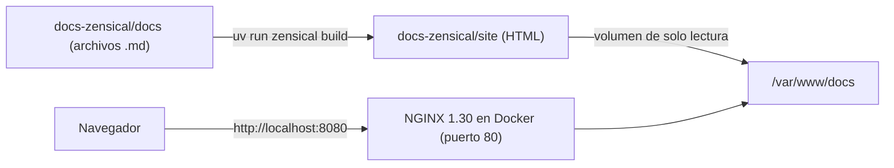

# NGINX para todos y todos para NGINX

Práctica de DPL (2º DAM, curso 2026-2027). Diego Alejandro Gil González.

## Índice

- [Objetivo](#objetivo)
- [Instalación](#instalación)
- [Configuración](#configuración)
- [Comprobación](#comprobación)
- [Problemas encontrados y solución](#problemas-encontrados-y-solución)
- [Repositorio remoto](#repositorio-remoto)
- [Relación curricular](#relación-curricular)

## Objetivo

Servir dos webs estáticas con un mismo servidor NGINX:

1. Fase 1: la documentación del repositorio [monium/gitanddocs](https://github.com/monium/gitanddocs), generada con Zensical.
2. Fase 2: un blog personal hecho con Jekyll.

NGINX no se instala en el Mac, va dentro de un contenedor Docker. Las webs se generan en el Mac y el contenedor las lee desde una carpeta compartida.

Así queda la fase 1:



## Instalación

### Herramientas

En el Mac instalo Docker Desktop y uv con Homebrew:

```bash
brew install --cask docker-desktop
brew install uv
open -a Docker
```

Compruebo que Docker funciona y la versión de uv:

```text
$ docker run --rm hello-world
[...]
Hello from Docker!
This message shows that your installation appears to be working correctly.
[...]

$ uv --version
uv 0.13.1 (Homebrew 2026-10-14 aarch64-apple-darwin)
```

### Repositorio e identidad de git

Creo el proyecto con su propio repositorio y pongo mi nombre y correo del aula virtual con `--local`, para que vayan dentro del `.git` del ZIP:

```bash
git init -b main
git config --local user.name "Diego Alejandro Gil González"
git config --local user.email "diegogildam@gmail.com"
```

```text
$ git log --format='%an <%ae>' | sort -u
Diego Alejandro Gil González <diegogildam@gmail.com>
```

### Copia de la documentación de gitanddocs

Clono el repo original fuera del proyecto y copio solo los archivos con `git archive`. Así no me traigo su historial, que tiene commits de otras personas. Quito su carpeta `.github` porque son las plantillas y el workflow de ese repo, no del mío.

```bash
git clone https://github.com/monium/gitanddocs.git /tmp/gitanddocs
git -C /tmp/gitanddocs log -1 --format='%h %cd'
mkdir docs-zensical
git -C /tmp/gitanddocs archive HEAD | tar -x -C docs-zensical
rm -r docs-zensical/.github
```

```text
3e7a2df Thu Oct 15 00:55:50 2026 +0100
```

La copia corresponde al commit `3e7a2df` de monium/gitanddocs.

### Generar la web con Zensical

`uv sync --locked` instala Python 3.14 y Zensical en las versiones exactas de `uv.lock`. `zensical build` convierte los `.md` de `docs/` en la web de `site/`.

```text
$ cd docs-zensical
$ uv sync --locked
Using CPython 3.14.8 interpreter at: /opt/homebrew/opt/python@3.14/bin/python3.14
Creating virtual environment at: .venv
Resolved 12 packages in 12ms
Installed 11 packages in 135ms
 + click==8.5.0
 + deepmerge==3.0.1
 + jinja2==3.1.6
 + markdown==3.11
 + markupsafe==3.0.3
 + pathspec==1.1.1
 + pygments==2.21.0
 + pymdown-extensions==12.1
 + pyyaml==6.0.3
 + tomli==2.4.1
 + zensical==0.0.65

$ uv run zensical build
Build started
Warning: anchor does not exist
    ╭─[ index.md:22:25 ]
[...]
4 issues found
Build finished in 0.19s

$ ls site
404.html           assets             get-site           gitea              index.html         markdown           search.json        sitemap.xml        tema-visual        trabajando-con-git
```

Los avisos de `anchor does not exist` están explicados en [Problemas encontrados](#problemas-encontrados-y-solución).

### Crear el blog con Jekyll

Jekyll está hecho en Ruby. Para no instalar Ruby en el Mac lo uso dentro de un contenedor con la imagen oficial `ruby:3.4`. Lo añado a `compose.yaml` como un segundo servicio:

```yaml
  # solo para crear y generar el blog, no se queda encendido
  jekyll:
    image: ruby:3.4
    working_dir: /srv/jekyll
    volumes:
      - ./blog-jekyll:/srv/jekyll
      # las gemas se guardan aquí para no descargarlas cada vez
      - gemas:/usr/local/bundle
    environment:
      JEKYLL_ENV: production
    command: sh -c "bundle install && bundle exec jekyll build"
    profiles: ["herramientas"]

volumes:
  gemas:
```

- `profiles: ["herramientas"]` hace que no arranque con `docker compose up`. Solo se usa cuando lo llamo con `docker compose run`.
- El volumen `gemas` guarda las gemas de Ruby para no descargarlas cada vez.
- `JEKYLL_ENV: production` genera el blog en modo producción.

Creo el blog con Jekyll 4.4.1 dentro del contenedor. `jekyll new` usa el tema minima por defecto:

```text
$ mkdir blog-jekyll
$ docker compose run --rm jekyll sh -c "gem install jekyll -v 4.4.1 && jekyll new . --force"
[...]
Successfully installed jekyll-4.4.1
29 gems installed
[...]
  Bundler: Bundle complete! 7 Gemfile dependencies, 39 gems now installed.
  Bundler: Use `bundle info [gemname]` to see where a bundled gem is installed.
New jekyll site installed in /srv/jekyll.

$ ls -a blog-jekyll
_config.yml    _posts         .              ..             .gitignore     404.html       about.markdown Gemfile        Gemfile.lock   index.markdown
```

Genero el blog. Sin más argumentos el contenedor ejecuta su `command`, que instala las gemas y hace `jekyll build`:

```text
$ docker compose run --rm jekyll
Bundle complete! 7 Gemfile dependencies, 39 gems now installed.
Use `bundle info [gemname]` to see where a bundled gem is installed.
Configuration file: /srv/jekyll/_config.yml
            Source: /srv/jekyll
       Destination: /srv/jekyll/_site
 Incremental build: disabled. Enable with --incremental
      Generating...
       Jekyll Feed: Generating feed for posts
Deprecation Warning [import]: Sass @import rules are deprecated and will be removed in Dart Sass 3.0.0.
[...]
Warning: 6 repetitive deprecation warnings omitted.
Run in verbose mode to see all warnings.
                    done in 0.193 seconds.
 Auto-regeneration: disabled. Use --watch to enable.

$ ls blog-jekyll/_site
404.html   about      assets     feed.xml   index.html jekyll
```

## Configuración

### Estructura del proyecto

```text
nginx-para-todos/
├── .github/workflows/ci.yml
├── .gitignore
├── README.md
├── compose.yaml
├── docs-zensical/          copia de monium/gitanddocs (commit 3e7a2df)
│   ├── docs/               los textos en Markdown
│   ├── pyproject.toml
│   ├── uv.lock
│   ├── zensical.toml
│   └── site/               web generada, no se versiona
└── nginx/
    └── conf.d/
        └── docs.conf
```

### site_url de Zensical

En `docs-zensical/zensical.toml` cambio la línea 2. Venía con `https://www.example.com/` y Zensical la usa en el `sitemap.xml` y en los enlaces canónicos de cada página:

```toml
site_url = "http://localhost:8080/"
```

```text
$ grep -o 'rel="canonical"[^>]*' docs-zensical/site/index.html
rel="canonical" href="http://localhost:8080/"
```

### compose.yaml

```yaml
services:
  nginx:
    image: nginx:1.30
    container_name: nginx-para-todos
    ports:
      - "8080:80"
    volumes:
      # mi configuración sustituye a la que trae la imagen
      - ./nginx/conf.d:/etc/nginx/conf.d:ro
      # la web que genera zensical
      - ./docs-zensical/site:/var/www/docs:ro
```

- `nginx:1.30` es la imagen oficial en su versión estable. Pongo la versión exacta para que no cambie sola.
- `8080:80` une el puerto 8080 del Mac con el 80 del contenedor, que es donde escucha NGINX.
- Los volúmenes comparten carpetas del Mac con el contenedor. `:ro` es solo lectura, NGINX no puede modificarlas.

### nginx/conf.d/docs.conf

```nginx
# Documentación de gitanddocs generada con Zensical
server {
    listen 80;
    server_name localhost;

    root /var/www/docs;
    index index.html;
    absolute_redirect off;

    location / {
        try_files $uri $uri/ =404;
    }

    error_page 404 /404.html;
}
```

- `server` es un sitio web. `listen` es el puerto y `server_name` el nombre del sitio.
- `root` es la carpeta de la web dentro del contenedor.
- `index` es el archivo que se entrega cuando se pide una carpeta.
- `absolute_redirect off` hace que las redirecciones no pierdan el puerto 8080 (ver [Problemas encontrados](#problemas-encontrados-y-solución)).
- `try_files` busca primero un archivo, luego una carpeta y si no hay nada responde 404.
- `error_page 404` enseña la página de error de Zensical en vez de la de NGINX.

### Arranque

```text
$ docker compose up -d
[+] up 2/2
 ✔ Network nginx-para-todos_default Created
 ✔ Container nginx-para-todos       Started

$ docker compose ps
NAME               IMAGE        COMMAND                  SERVICE   CREATED         STATUS         PORTS
nginx-para-todos   nginx:1.30   "/docker-entrypoint.…"   nginx     6 seconds ago   Up 5 seconds   0.0.0.0:8080->80/tcp, [::]:8080->80/tcp
```

Cuando cambio la configuración, la reviso y la recargo sin parar el contenedor:

```text
$ docker compose exec nginx nginx -t
nginx: the configuration file /etc/nginx/nginx.conf syntax is ok
nginx: configuration file /etc/nginx/nginx.conf test is successful

$ docker compose exec nginx nginx -s reload
2026/10/18 17:48:45 [notice] 38#38: signal process started
```

### CI

`.github/workflows/ci.yml` se ejecuta en cada PR y en cada push a `main`. Genera la documentación, revisa la configuración con `nginx -t`, arranca NGINX y comprueba que responde y que la redirección mantiene el puerto.

### El blog

El blog se llama "Mi temporada culé" y trata de cómo estoy viviendo la temporada del Barça. Uso el tema minima, que es el que trae Jekyll.

`blog-jekyll/_config.yml`:

```yaml
# Configuración del blog. Si cambio algo aquí hay que volver a generar el blog.
title: Mi temporada culé
description: >-
  Blog personal donde cuento cómo estoy viviendo la temporada 2026-2027 del Barça.
lang: es
baseurl: ""
url: "http://blog.local:8080"
github_username: diegoalegil

minima:
  date_format: "%d/%m/%Y"

theme: minima
plugins:
  - jekyll-feed
```

- `url` es la dirección donde va a estar el blog. Jekyll la usa en el feed y en las etiquetas para buscadores.
- `lang: es` pone el idioma de las páginas en español.
- `date_format` muestra las fechas como 18/10/2026.

Cambios en el contenido:

- Borro la entrada de ejemplo `welcome-to-jekyll` con `git rm`.
- Escribo dos entradas en `_posts/`: `2026-10-18-vuelvo-a-ver-al-barca.markdown` y `2026-10-18-diez-de-diez.markdown`. El nombre tiene que empezar por la fecha, si no Jekyll no las toma como entradas.
- Paso a español la página "Sobre mí" (`about.markdown`, ahora en `/sobre-mi/`), el título de la lista de entradas (`list_title` en `index.markdown`) y la página 404.

## Comprobación

### Fase 1

La portada responde con `200 OK`:

```text
$ curl -I http://localhost:8080/
HTTP/1.1 200 OK
Server: nginx/1.30.6
Date: Sun, 18 Oct 2026 17:44:59 GMT
Content-Type: text/html
Content-Length: 40775
Last-Modified: Sun, 18 Oct 2026 17:43:01 GMT
Connection: keep-alive
ETag: "6ad50525-9f47"
Accept-Ranges: bytes
```

Una carpeta sin barra final redirige a la misma ruta con barra, sin perder el puerto:

```text
$ curl -I http://localhost:8080/markdown
HTTP/1.1 301 Moved Permanently
Server: nginx/1.30.6
Date: Sun, 18 Oct 2026 17:48:58 GMT
Content-Type: text/html
Content-Length: 169
Connection: keep-alive
Location: /markdown/
```

Una página que no existe da `404` con la página de error de Zensical (pesa 17614 bytes, la de NGINX son unos 150):

```text
$ curl -I http://localhost:8080/esto-no-existe
HTTP/1.1 404 Not Found
Server: nginx/1.30.6
Date: Sun, 18 Oct 2026 18:19:19 GMT
Content-Type: text/html
Content-Length: 17614
Connection: keep-alive
ETag: "6ad50525-44ce"
```

En el navegador, http://localhost:8080 muestra la documentación con su tema y http://localhost:8080/esto-no-existe la página de error con el mismo diseño.

La CI pasa en la PR de la fase 1:

```text
$ gh pr checks 4
comprobar	pass	23s	https://github.com/diegoalegil/nginx-para-todos/actions/runs/39151396787/job/117745610815
```

## Problemas encontrados y solución

**Avisos `anchor does not exist` al generar la documentación.** `zensical build` avisa de 4 enlaces del índice de `docs/index.md` que apuntan a apartados que no existen. Vienen así en el repo original y la web se genera igual. No los toco porque la documentación es de gitanddocs, no mía.

**`Failed to spawn: zensical`.** Me pasó al ejecutar `uv run zensical build` fuera de la carpeta `docs-zensical`. uv busca el proyecto en la carpeta actual y ahí no estaba Zensical. Se arregla haciendo `cd docs-zensical` antes.

**La redirección perdía el puerto.** Al pedir `http://localhost:8080/markdown` sin la barra final, NGINX respondía `301` con `Location: http://localhost/markdown/`. Dentro del contenedor escucha en el 80, así que escribía la dirección sin el `:8080` y el navegador acababa en el puerto 80 del Mac, donde no hay nada. Lo arreglo con `absolute_redirect off`, que hace la redirección relativa (`Location: /markdown/`).

**El sitemap apuntaba a example.com.** El `site_url` de `zensical.toml` venía con `https://www.example.com/`. Lo cambio por `http://localhost:8080/`.

**`no such service: jekyll`.** Me salió la primera vez que lancé `docker compose run --rm jekyll`, porque el servicio `jekyll` todavía no estaba guardado en `compose.yaml`. Al añadirlo, el mismo comando funciona.

**Avisos `Deprecation Warning` al generar el blog.** Vienen del tema minima 2.5.2, que usa `@import` y funciones de Sass como `lighten()` que las versiones nuevas de Sass marcan como obsoletas. Son avisos del tema, no errores, y el blog se genera bien.

## Repositorio remoto

https://github.com/diegoalegil/nginx-para-todos

- Issues: [#1 Fase 1](https://github.com/diegoalegil/nginx-para-todos/issues/1), [#2 Fase 2](https://github.com/diegoalegil/nginx-para-todos/issues/2) y [#3 CI](https://github.com/diegoalegil/nginx-para-todos/issues/3).
- Cada fase se hace en su rama (`fase-1`, `fase-2`) y entra en `main` con una PR. Fase 1: [PR #4](https://github.com/diegoalegil/nginx-para-todos/pull/4).

## Relación curricular

**RA1. Implantar arquitecturas web.**

- b) Explico cómo responde NGINX a las peticiones HTTP: códigos 200, 301 y 404 y la cabecera `Location`.
- c) Instalo y configuro NGINX en un contenedor con Docker Compose.
- f) Pruebo el servidor con `curl`, con `nginx -t` y con la CI.
- g) Describo la estructura de la web generada (`index.html`, `assets`, `404.html`, `sitemap.xml`).
- h) Indico lo que hace falta para desplegar: Docker, el puerto 8080 libre y la web generada antes de arrancar.
- i) Documento la instalación y la configuración en este README.

**RA6. Elaborar la documentación de la aplicación web.**

- a) Uso Zensical como generador de documentación.
- b) Genero la documentación de gitanddocs con Zensical.
- c) Uso varios formatos: Markdown, HTML, TOML, YAML y diagramas Mermaid.
- d) Uso GitHub con issues y pull requests.
- h) Uso GitHub Actions para la integración continua.
